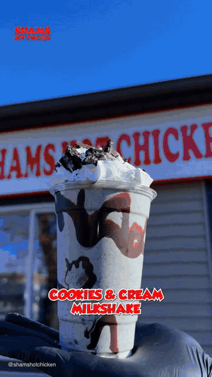
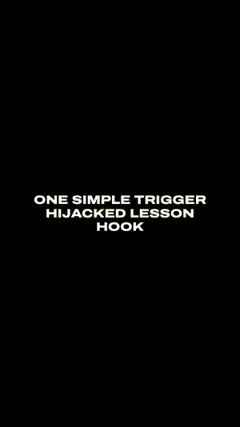
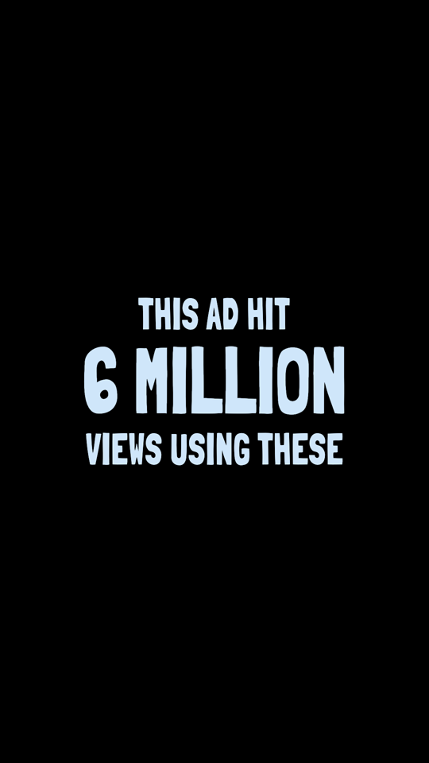
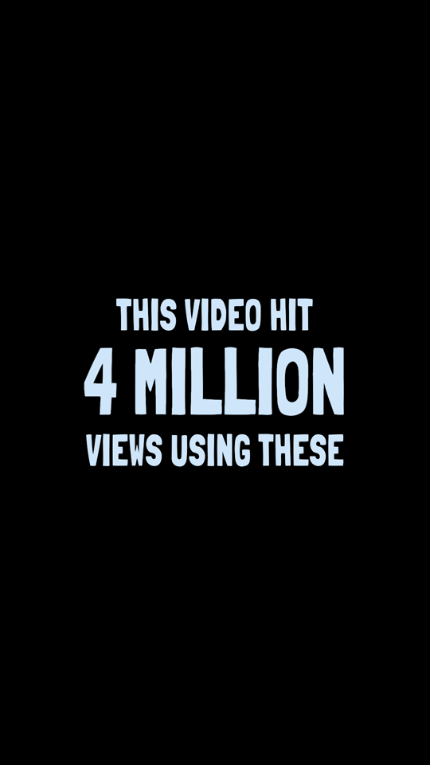
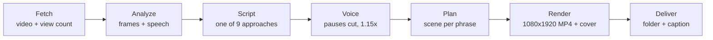

<p align="center">
  
</p>

<h1 align="center">Viral Hook Reels</h1>

<p align="center">
  <b>A Claude Code skill that turns any viral video link into a finished "why this went viral" reel.</b><br>
  Script, voiceover, captions, edit, cover and post caption. One command, about five minutes.
</p>

<p align="center">
  <a href="LICENSE"></a>
  
  <a href="https://postaxis.io/?utm_source=github&utm_medium=readme&utm_campaign=viral-hook-reels"></a>
</p>

```
/hook-reel https://www.instagram.com/reel/XXXXXXXX/ follow
```

You know the format: a viral video plays, freezes, and a fast voice says *"This video pulled 6.8 million views, and surprisingly, it was an ad."* Then three psychology triggers, a formula, and a call to action. Those reels get millions of views and take an editor an hour each.

This skill makes one from a link. Claude watches the video, finds the second where the viewer "gets it", writes a script about that specific video, records the voice, cuts the edit and renders a 1080 x 1920 MP4.

Made by the team behind [PostAxis](https://postaxis.io/?utm_source=github&utm_medium=readme&utm_campaign=viral-hook-reels), the social media scheduler built for AI agents.

## What comes out

Three moments from three reels this skill made. Previews are silent and shrunk; the real files are full HD with voice.

| 1. The opening plays, then the cut | 2. The breakdown | 3. The ending |
|:---:|:---:|:---:|
|  |  |  |
| The source plays untouched until the viewer understands it. Then the frame freezes and the view count stacks up. | Replays of the exact moment being described, footage cards and text cards, one caption word at a time. | The formula in one line, then the ending you picked. Here: comment a keyword. |
| Source: [shamshotchicken](https://www.instagram.com/p/DfktyQBlLN9/), 6.8M views | Source: [jackson.rips](https://www.instagram.com/p/DffaQnRPtd2/), 4.9M views | Source: [wantsandneedsbrand_](https://www.instagram.com/reel/DNJ_qVKsVcY/), 16.2M views |

Every reel also gets a cover picture and a caption to paste:

<p align="center">
  
  
  
</p>

## Quick start

**1. Install the tools** (macOS shown; Claude Code must already be installed and signed in)

```bash
brew install node ffmpeg yt-dlp
```

**2. Install the skill**

```bash
git clone https://github.com/dovudhusan/viral-hook-reels ~/.claude/skills/hook-reel
```

**3. Add your ElevenLabs key.** In Claude Code, run `/hook-reel` once. It installs the engine's packages (a few minutes, one time) and creates `~/.claude/skills/hook-reel/engine/.env`. Open that file and fill in `ELEVENLABS_API_KEY`. Type the key into the file yourself; don't paste it into the chat.

**4. Make a reel**

```
/hook-reel https://www.instagram.com/reel/XXXXXXXX/ follow
```

Or just say it: *"make a hook reel from this link, end with save."* The MP4, its cover and the caption land in `~/Movies/Hook Reels`.

| You need | Why |
|---|---|
| [Claude Code](https://claude.com/claude-code) | Runs the skill and writes the script on your Claude plan (no API key needed) |
| Node 22+, ffmpeg, yt-dlp | Render, audio work, downloading the source |
| An [ElevenLabs](https://elevenlabs.io) API key | The voiceover, with word timings for the captions. About 700 characters per reel |
| Chrome, logged into Instagram | Only for Instagram links. TikTok and YouTube Shorts links need nothing |

Built and tested on macOS. Linux should work; Windows is untested.

## What Claude does with your link



Then Claude checks its own work the way an editor would: it looks at the frames around the cut, reads the script for lines that could be said about any video, and looks at a contact sheet of the finished reel before telling you it is ready. If something is off, it edits the script and re-runs only the stages that changed.

Every job is resumable. A failed render does not cost you a second voiceover.

## The rules that make it not look like AI slop

Most of the work went into these. They are in [SKILL.md](SKILL.md) and enforced by the engine.

1. **The cut waits for the payoff.** The script records the second a first-time viewer understands what the opening leads to (for an ad, the second the product is on screen). The source plays until two to four seconds after that. Cutting in early is the worst mistake: the voice says "it was an ad" and nobody has seen the ad.
2. **The script is about this video.** What is on screen, at which second, and what the viewer's brain does. A line that could be read over any video fails the check.
3. **No two reels in a row sound the same.** Nine script approaches, three offered per reel, never one that the last three reels used. The engine also shows Claude your last ten scripts so it stops repeating phrases.
4. **The voice is fast like a creator, not like a chipmunk.** Pauses are cut out, then the audio runs at 1.15x.
5. **Captions are word-timed.** White, uppercase, either one word at a time or a phrase building up, driven by the real timings of the recorded voice.
6. **The picture follows the words.** When the voice describes a moment, that exact moment replays. Names get text cards. "Number one" gets a number card.
7. **Sound effects are rare.** One per scene change that deserves it. Not one per caption.
8. **The source is credited** on screen, and the video is never mirrored to hide where it came from.

## Nine ways to break down a hook

The engine picks from these. They are also just a useful list if you write breakdowns by hand.

| Approach | Use it when | Opening line |
|---|---|---|
| `ad-reveal` | The video turns out to be an ad | "This video pulled over 6.8 million views, and surprisingly, it was an ad for …" |
| `named-hook` | The hook deserves a name | "… and it used one powerful hook, the fake science lesson hook." |
| `one-trigger` | One idea carries the whole video | "… and your brain fell for it before you even realized." |
| `crazy-part` | One surprising fact is visible in it | "… but here's the crazy part. Nobody in it says a single word." |
| `same-concept` | Any brand could copy it | "… and any brand can use the exact same concept." |
| `odd-setting` | An ordinary thing in the wrong place | "… and it wasn't shot in a barbershop, it was shot in a moving truck." |
| `timing` | It rode a season, a fear or a trend | "This video pulled over 7.6 million views in the first week of December." |
| `this-is` | A label says it all | "This is a wrong answer hook, and it pulled 9.1 million views." |
| `contrast` | It kept what most would cut out | "… by doing what most brands would cut out." |

A full example voiceover for each is in [engine/src/examples.ts](engine/src/examples.ts).

## Six endings

Pass one after the link. The default is `hooks`.

| Ending | The reel closes on | Good for |
|---|---|---|
| `hooks` | "Comment hooks, and I'll send you …" over a blurred document | Comment-to-DM automations |
| `viral` | "Comment viral, and I'll send you psychology-based hooks …" | The same, with a second keyword |
| `follow` | The follow button being tapped | Growing the account |
| `save` | The save button being tapped | Saves |
| `share` | The share button being tapped | Reach |
| `like` | The heart being tapped | A light ask |

The keyword and the offer are yours to set in `engine/config.json`.

## Two-clip comparisons

*"This is the failed version. 13 million views. This is the good version. 2 million."* For reels that compare two clips, Claude writes a small spec file and runs the `compare` command: clip one plays and gets a label, clip two plays and gets a label, then the voice explains the difference over replays. Ask for it in words: *"compare these two videos"*. The spec format is in [reference.md](reference.md).

## Make it yours

| Change | How |
|---|---|
| Music | Save a track as `engine/assets/music/bed.mp3`. None ships, so you can also add a trending sound in the app when you post |
| Reaction cutaways | Drop `confused.mp4`, `shocked.mp4`, `mindblown.mp4`, `thinking.mp4` into `engine/assets/reactions`. Film your own face; it makes the reels yours |
| Voice | `voiceId` in `engine/config.json` (any ElevenLabs voice), `voiceTempo` for speed |
| Call to action | `cta.keyword` and `cta.offer` in `engine/config.json` |
| Output folder | `outputDir` in `engine/config.json`. Point it at a synced Drive or iCloud folder to get reels on your phone |
| Telegram ping when a reel is done | `TELEGRAM_BOT_TOKEN` and `TELEGRAM_CHAT_ID` in `engine/.env` |

To update: `git -C ~/.claude/skills/hook-reel pull`. Your `.env` and your jobs are untouched.

## Made the reel? Now get it posted

A reel sitting in a folder gets zero views. **[PostAxis](https://postaxis.io/?utm_source=github&utm_medium=readme&utm_campaign=viral-hook-reels)** is the scheduler we built for exactly this kind of workflow:

- **Upload once, post everywhere.** The same file goes out as an Instagram Reel, a TikTok and a YouTube Short, plus X, LinkedIn, Facebook, Threads and Telegram.
- **Built for AI agents.** PostAxis connects to Claude, Claude Code, ChatGPT, Cursor or any MCP agent. Ask in plain words and the agent plans the week and schedules the posts.
- **It checks each network's rules first**, so a post does not fail at publish time because of a length or format limit.
- **A calendar you can review** before anything goes live, and a REST API if you would rather script it.

Make a week of breakdown reels on Sunday, schedule one a day, and stop thinking about it. There is a [7-day trial for $0](https://postaxis.io/?utm_source=github&utm_medium=readme&utm_campaign=viral-hook-reels).

## Use it responsibly

- **The source video belongs to its creator.** The reel shows part of it to comment on it, and credits the account on screen. Keep the credit on, add commentary that is worth watching, and take a reel down if a creator asks you to.
- **Nothing is posted for you.** The skill saves files. You decide what goes out.
- **Your keys stay on your computer** in `engine/.env`, which git ignores. The skill is told never to read that file back or ask for a key in chat.
- **Instagram links use your own Chrome session**, read on your machine by yt-dlp at download time. Nothing is stored or sent anywhere else.
- **Remotion renders the video.** It is free for individuals and small teams; larger companies need a licence. See [remotion.dev/license](https://www.remotion.dev/license).
- **View counts are never invented.** If a link reports none, the skill asks you for the number.

## Troubleshooting

| Problem | Fix |
|---|---|
| "Log into Instagram in Chrome" | Log in at instagram.com in Chrome, then tell Claude to resume the job |
| `voiceKey: false` after setup | `ELEVENLABS_API_KEY` is missing in `engine/.env` |
| The cut is too early or too late | Tell Claude: "the cut should be at 0:27". It re-plans without recording the voice again |
| The voice is too fast | "Set the voice tempo to 1.05 and redo the voice" |
| Render fails with "got no response" | The engine retries three times by itself. Ask Claude to resume once more |
| The script is rejected twice | The video is probably too short or has no clear payoff. Try another one |

## What is in the repo

```
SKILL.md          What Claude follows: setup, make, check, fix, hand over
reference.md      Approaches, script fields, scene types, the two-clip spec
scripts/setup.sh  Finds the engine, installs packages, reports what is missing
engine/           The program: TypeScript CLI + Remotion scenes (src/, remotion/, assets/)
examples/         The pictures on this page
```

## Contributing

Issues and pull requests are welcome, especially new script approaches, new scene types and fixes for Linux or Windows. If this saved you an afternoon of editing, a star helps other people find it.

## Licence

MIT. See [LICENSE](LICENSE). Sound effects are CC0 and the cover font is under the SIL Open Font License; details in [engine/assets/CREDITS.md](engine/assets/CREDITS.md).

<p align="center">
  Built by <a href="https://postaxis.io/?utm_source=github&utm_medium=readme&utm_campaign=viral-hook-reels"><b>PostAxis</b></a>: put your social media on autopilot with AI agents.
</p>
